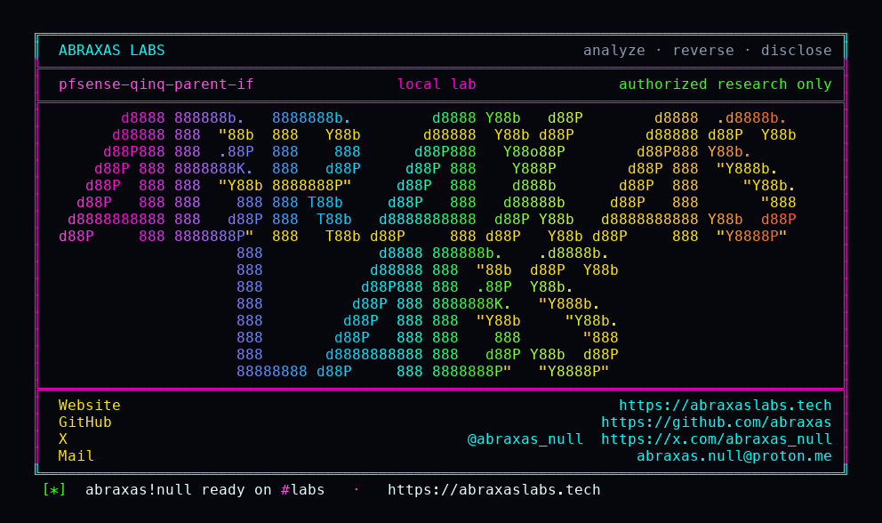

<p align="center">
  
</p>

<p align="center">
  <a href="https://abraxaslabs.tech"><strong>abraxaslabs.tech</strong></a>
  &nbsp;·&nbsp;
  <a href="https://github.com/abraxas">github.com/abraxas</a>
  &nbsp;·&nbsp;
  <a href="https://x.com/abraxas_null">@abraxas_null</a>
  &nbsp;·&nbsp;
  <a href="mailto:abraxas.null@proton.me">abraxas.null@proton.me</a>
  &nbsp;·&nbsp;
  <a href="https://github.com/abraxas/pfsense-qinq-parent-if">pfsense-qinq-parent-if</a>
</p>
<p align="center">
  Write-up: <a href="https://abraxaslabs.tech/research/pfsense-qinq-parent-if"><strong>https://abraxaslabs.tech/research/pfsense-qinq-parent-if</strong></a>
</p>


# pfsense-qinq-parent-if

**Class:** RCE
**Reach:** Remote

**pfSense CE** `2.9.0-DEVELOPMENT` (`9363ac5`) - [pfsense.org](https://www.pfsense.org)

QinQ edit stores a parent interface name with no `does_interface_exist` check. VLAN edit already rejects a parent that is not a live iface. `Form_Select` does not re-validate POST. Create `write_config`s even when `interface_qinq_configure` returns early. Member add/remove then interpolates the stored `vlanif` into unescaped `ifconfig`. PHP `exec` is `/bin/sh -c`. WebGUI PHP-FPM is root. Privilege is `page-interfaces-qinq-edit`, not Diagnostics: Command.

| | |
|---|---|
| ID | no CVE yet |
| Class | **RCE** |
| Reach | **Remote** (authenticated WebGUI) |
| CWE | [CWE-78](https://cwe.mitre.org/data/definitions/78.html) |
| CVSS | **High: 8.8** `CVSS:3.1/AV:N/AC:L/PR:L/UI:N/S:U/C:H/I:H/A:H` |
| Product | [pfSense CE](https://github.com/pfsense/pfsense) |
| Affected | **2.9.0-DEVELOPMENT** (`9363ac5b8651a1c7a333180425ce7719070f95f9`) QinQ edit |
| Auth | WebGUI session with `page-interfaces-qinq-edit` |
| License | [GNU Affero GPL v3.0](LICENSE) |
| Lab | `127.0.0.1` only |

I pinned public master [9363ac5](https://github.com/pfsense/pfsense/commit/9363ac5b8651a1c7a333180425ce7719070f95f9). The lab is a PHP gadget of the pinned `vlan_interface` / `interface_qinq_configure` / member `exec` lines, loopback HTTP on `127.0.0.1:18810`.

## What an attacker can do

| Method | Sink | Privilege |
|---|---|---|
| POST QinQ create with a parent that is not a live iface, then POST edit adding a member | `interface_qinq2_configure` `exec` `ifconfig vlan create ...` (`interfaces.inc:620`) | **Integrity (lab-proven):** root shell via `/bin/sh -c`. Lab: member-add qinq2 wrote the witness (`member-sink=yes`). |
| Same stored `vlanif`, POST edit removing a member | `exec("/sbin/ifconfig {$parent}.{$tag} destroy")` (`interfaces_qinq_edit.php:212`) | **Integrity (lab-proven):** same root `exec`. Destroy has no `IF_NAMESIZE` cap. |
| Same root shell | host filesystem | **Recon (inferred):** `config.xml`, keys, other tenants. This page does not print `exec` output. |
| Root shell or broken `ifconfig` | vlan devices | **Availability (inferred):** create/destroy vlan devices; data plane is in play. |

**Lab-proven vs inferred:** VLAN reject, create-only no exec, IF_NAMESIZE block at len 16, and member-add qinq2 witness are lab-proven. Filesystem recon and data-plane disruption are inferred from root PHP-FPM.

**Requires:** WebGUI session with `page-interfaces-qinq-edit`. CSRF token. Two POSTs (create, then member edit). Default admin has the page. A limited user can be granted only this page.

## Adjacent surface that stays closed

| Surface | Lab |
|---|---|
| VLAN parent existence check | `vlan-rejected=yes` |
| QinQ create-only (parent missing) | stores config, `create-no-exec=yes` |
| qinq2 name length 16 | `if-namesize-block=yes` before exec |
| Unauth / CSRF without token | `guiconfig` + CSRF-magic |
| GIF/GRE name regex, LAGG members `does_interface_exist` + `escapeshellarg` | other pages |
| QinQ list delete of a never-created parent | `does_interface_exist($vlanif)` |
| Diagnostics: Command | stays closed unless also granted |

No Diagnostics: Command. No unauth. Historical class is CVE-2023-42326 GIF/GRE, different page.

## Lab

```bash
cd lab
./run.sh
```

Loopback `127.0.0.1:18810`. Compose project `pfsense-qinq-parent-if`. Image tag `pfsense-qinq-parent-if:2.9.0-dev`. Witness `PFSENSE-QINQ-PARENT-IF-WITNESS`. Last line:

```
SUCCESS PFSENSE-QINQ-PARENT-IF vlan-rejected=yes create-no-exec=yes member-sink=yes if-namesize-block=yes PFSENSE-QINQ-PARENT-IF-WITNESS
```

## The fix

QinQ edit: reject a parent that is not a live interface, same as VLAN edit. Integer-check member tags already exist; still `escapeshellarg` the stored `vlanif` before every `ifconfig`. Cap member-delete destroy the same way `interface_qinq2_configure` caps `IF_NAMESIZE`.

## References

- [github.com/pfsense/pfsense](https://github.com/pfsense/pfsense) `9363ac5b8651a1c7a333180425ce7719070f95f9`
- [`interfaces_qinq_edit.php`](https://github.com/pfsense/pfsense/blob/9363ac5b8651a1c7a333180425ce7719070f95f9/src/usr/local/www/interfaces_qinq_edit.php)
- [`interfaces.inc`](https://github.com/pfsense/pfsense/blob/9363ac5b8651a1c7a333180425ce7719070f95f9/src/etc/inc/interfaces.inc) `interface_qinq2_configure`
- VLAN contrast: [`interfaces_vlan_edit.php`](https://github.com/pfsense/pfsense/blob/9363ac5b8651a1c7a333180425ce7719070f95f9/src/usr/local/www/interfaces_vlan_edit.php)
- Historical class (GIF/GRE, not this page): CVE-2023-42326
- [CWE-78](https://cwe.mitre.org/data/definitions/78.html)
